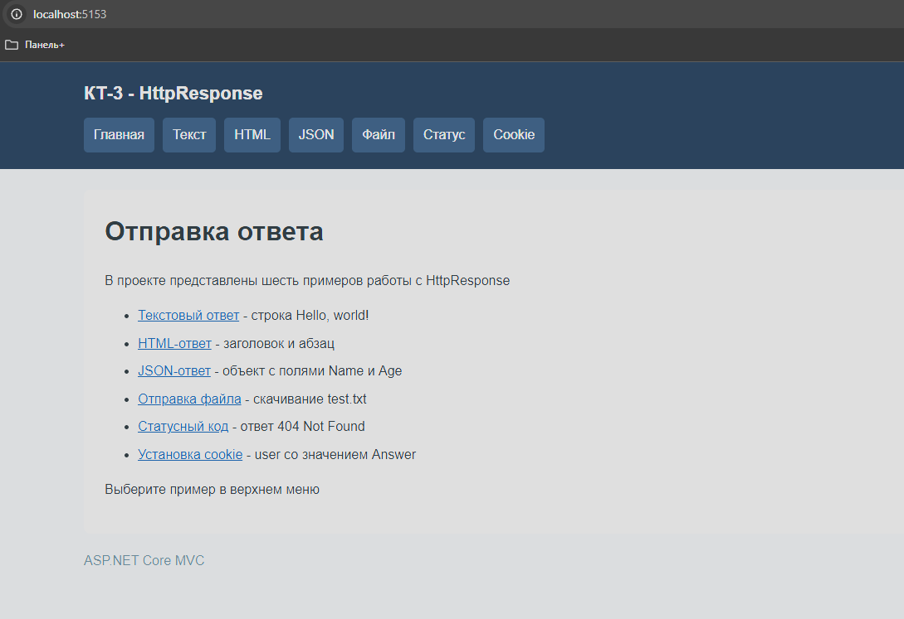
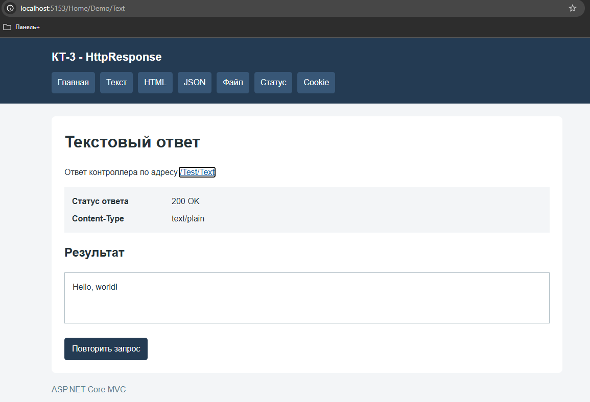
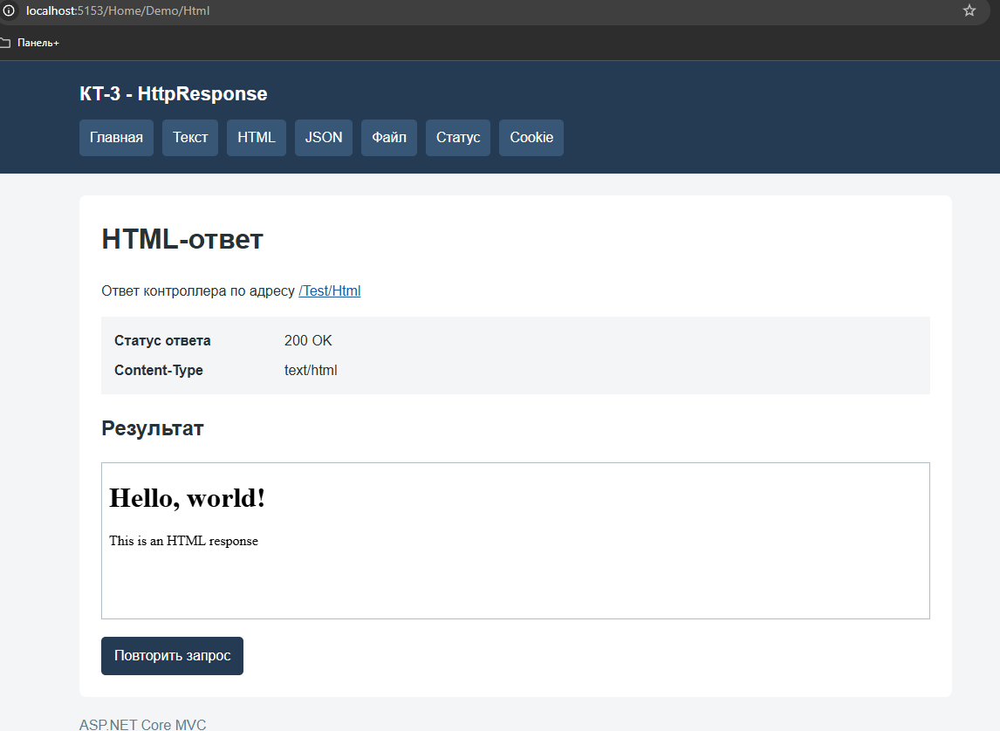
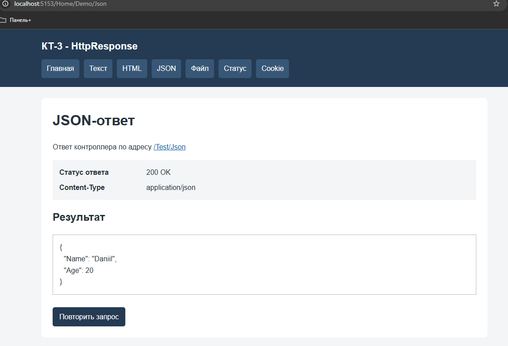
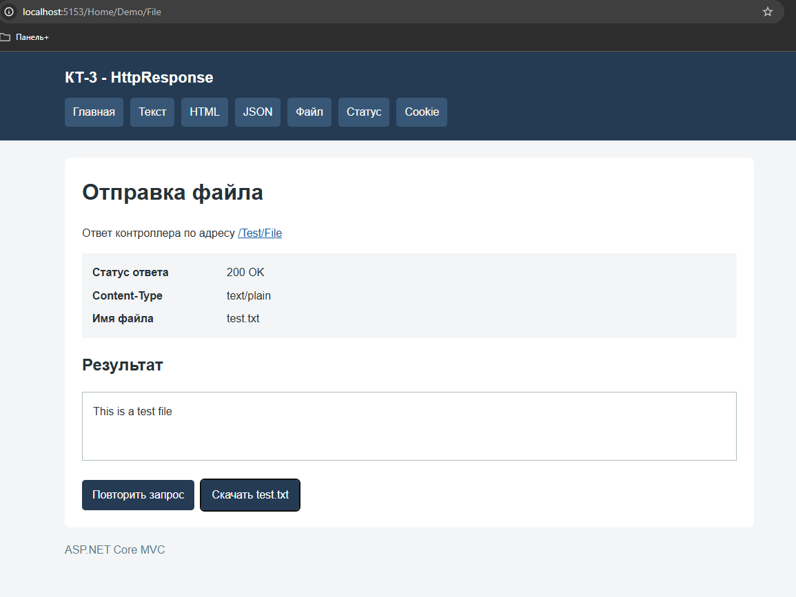
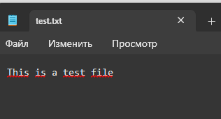
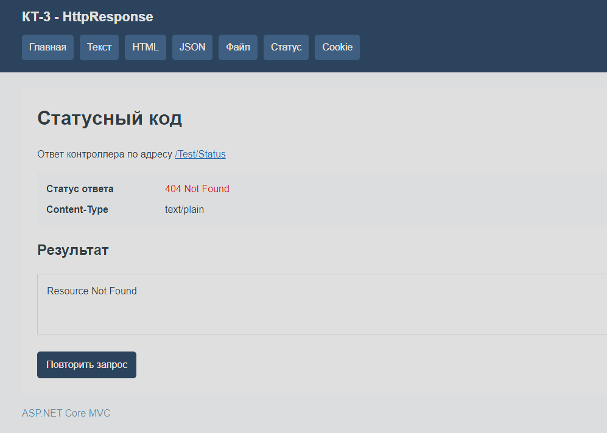
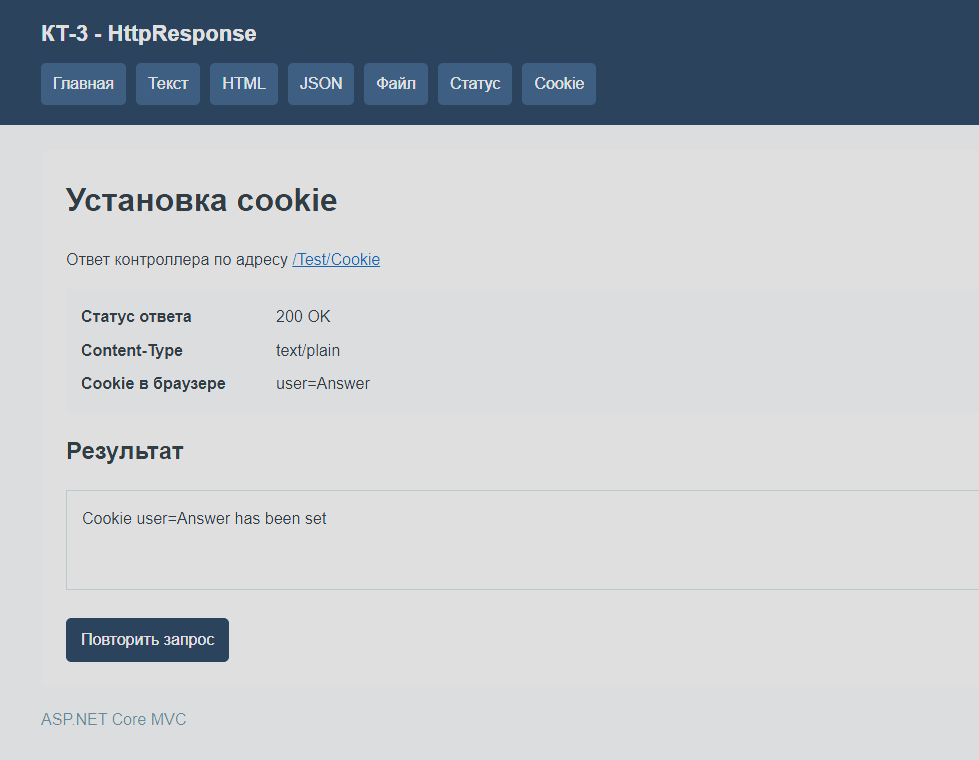
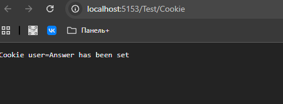

# КТ-3 - Отправка ответа HttpResponse

Студент - Денисенко Даниил Евгеньевич  
Группа - 4п4.23 NET  
Дисциплина - ADO.NET  

## Задачи:

Создайте новый проект ASP.NET Core MVC.

Добавьте новый контроллер с именем TestController в папку Controllers. Унаследуйте его от класса Controller и убедитесь, что он имеет суффикс Controller в имени.

Добавьте действие с именем Text в контроллер, которое возвращает строку “Hello, world!” в виде текстового ответа. Используйте метод WriteAsync для отправки строки и установите свойство ContentType в “text/plain”.

Добавьте действие с именем Html в контроллер, которое возвращает HTML-код с заголовком и абзацем в виде HTML-ответа. Используйте метод WriteAsync для отправки HTML-кода и установите свойство ContentType в “text/html”.

Добавьте действие с именем Json в контроллер, которое возвращает объект с двумя свойствами: Name и Age в виде JSON-ответа. Используйте метод WriteAsJsonAsync для отправки объекта и установите свойство ContentType в “application/json”.

Добавьте действие с именем File в контроллер, которое возвращает файл с именем test.txt, содержащий строку “This is a test file” в виде файла. Используйте метод SendFileAsync для отправки файла и установите свойство ContentType в “text/plain”.

Добавьте действие с именем Status в контроллер, которое возвращает статусный код 404 (Not Found) в виде ответа. Используйте свойство StatusCode для установки статусного кода и метод WriteAsync для отправки сообщения об ошибке.

Добавьте действие с именем Cookie в контроллер, которое устанавливает куки с именем “user” и значением “Answer” в виде ответа. Используйте свойство Cookies для установки куки и метод WriteAsync для отправки подтверждения.

Запустите проект и проверьте, что вы можете получить доступ к каждому действию по соответствующему URL, например, /Test/Text, /Test/Html, /Test/Json и т.д. Обратите внимание, как HttpResponse формирует ответ в зависимости от типа данных и заголовков.

### ЗАДАНИЕ 1:

На главной странице перечислены шесть примеров работы с HttpResponse
Общее меню позволяет перейти к текстовому ответу, HTML, JSON, отправке файла, статусному коду и установке cookie
Меню отображается на всех страницах демонстрации

На странице /Home/Demo/Text отображается строка Hello, world!
Ответ /Test/Text имеет статус 200 OK и Content-Type text/plain

В действии Text свойство Response.ContentType установлено в text/plain
Для записи строки в тело ответа используется Response.WriteAsync

### ЗАДАНИЕ 2
E

На странице /Home/Demo/Html показан результат отображения HTML
Заголовок Hello, world! и абзац This is an HTML response отображаются как элементы страницы
Ответ /Test/Html имеет статус 200 OK и Content-Type text/html

Действие Html устанавливает Response.ContentType в text/html и отправляет HTML-код методом Response.WriteAsync
Страница демонстрации отображает полученный HTML в iframe

### ЗАДАНИЕ 3

На странице /Home/Demo/Json отображается объект с полями Name и Age
Поле Name содержит значение Daniil, поле Age содержит число 20
Ответ /Test/Json имеет статус 200 OK и Content-Type application/json

Для отправки объекта используется Response.WriteAsJsonAsync
Настройки JsonSerializerOptions сохраняют имена полей Name и Age с заглавной буквы

### ЗАДАНИЕ 4

На странице /Home/Demo/File отображаются имя test.txt и содержимое файла
Ответ /Test/File имеет статус 200 OK и Content-Type text/plain
Кнопка «Скачать test.txt» позволяет получить файл через браузер

Файл находится в папке Files и содержит строку This is a test file
Действие File формирует путь к файлу и отправляет его методом Response.SendFileAsync
Заголовок Content-Disposition задаёт скачивание с именем test.txt

В Блокноте открыт скачанный файл test.txt
Его содержимое соответствует исходной строке This is a test file

### ЗАДАНИЕ 5

На странице /Home/Demo/Status отображаются код 404 Not Found и сообщение Resource Not Found
Статус относится к ответу /Test/Status

В действии Status свойство Response.StatusCode установлено в 404
Сообщение об ошибке записывается в тело ответа методом Response.WriteAsync
Страница демонстрации показывает результат запроса с сохранением общего меню

### ЗАДАНИЕ 6

На странице /Home/Demo/Cookie отображается подтверждение Cookie user=Answer has been set
В строке «Cookie в браузере» показано значение user=Answer
Ответ /Test/Cookie имеет статус 200 OK и Content-Type text/plain

В действии Cookie используется Response.Cookies.Append("user", "Answer")
Подтверждение отправляется методом Response.WriteAsync

После нажатия кнопки «Повторить запрос» страница снова выполняет запрос к /Test/Cookie
Подтверждение и значение user=Answer отображаются повторно
Обновление результата выполняется без перезагрузки всей страницы

